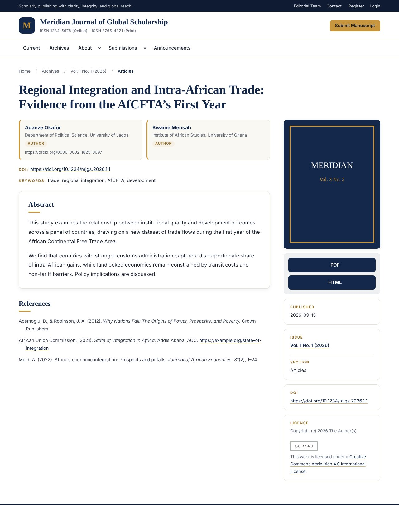
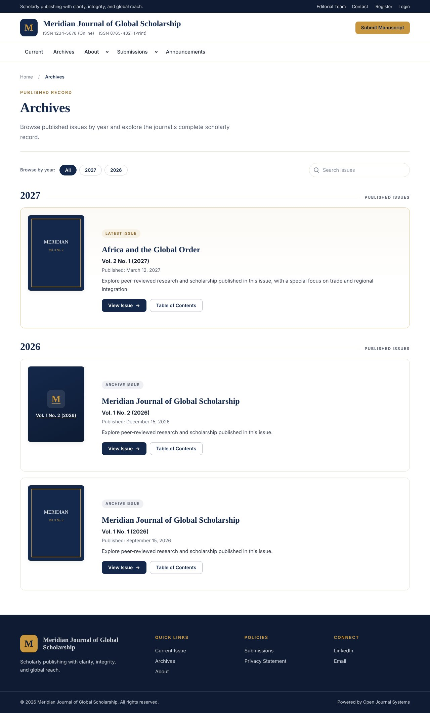

# Lumen: an editorial theme for Open Journal Systems


Lumen gives an OJS journal a modern, card-based homepage: a hero banner, a floating
highlights strip, a current-issue showcase with article cards, an About and subject-scope
section, announcements, indexing logos, a newsletter / submit call-to-action and a
four-column footer.

It is a **child of the Default theme**. Lumen replaces the header, footer, journal homepage
and issue archive, and re-lays-out the article and issue pages with CSS. Every other page
(search, login and so on) keeps working and is re-coloured and re-typeset to match.


<p>
  
  
</p>

### Article and archive pages





*Screenshots use placeholder content. The colours (right, in green) are set in one place under
Appearance > Theme, and the theme follows them everywhere. A full-page capture is in
[`docs/screenshots/home-full.jpg`](docs/screenshots/home-full.jpg).*

## Features

- **Colour you control.** Pick a primary and an accent colour; the whole theme, inner pages
  included, follows them.
- **Fully responsive**, with a mobile menu and keyboard-accessible submenus
  (caret buttons, Escape to close).
- **Article page:** author cards, a framed abstract, hanging-indent references, and a sticky
  details column (cover, PDF/HTML buttons, published date, issue, section, DOI, licence).
- **Issue archive:** issues grouped by year, with *Latest* / *Archive* labels, a year filter
  and a quick search (these two need JavaScript; without it the full list is shown).
- **Configurable homepage** from the admin screen: hero text, highlights strip, subject scope,
  indexing logos, newsletter box, footer tagline and social links. No template editing.
- **Sections hide themselves** when there is nothing to show (no issue, no announcements,
  no indexing list).
- **Five navigation areas** you can fill from Website > Navigation Menus.
- **Typography:** Inter and Source Serif 4, or system fonts if you would rather make no
  request to Google.
- **Works with the OJS journal Highlights carousel** on 3.5 (shown above the hero when set).
- Translatable (`locale/en/locale.po`).

## Compatibility

| OJS | Status |
|---|---|
| 3.5.x | Installed and working on 3.5.0.5 |
| 3.4.x | Written against the 3.4.0 source and tested with a template harness; reports welcome |
| 3.3 and older | Not supported |

Requires PHP 8.1 or newer (the same as OJS 3.4 / 3.5) and the Default theme, which always
ships with OJS.

## Install

> **Do not use GitHub's green "Code > Download ZIP" button.** That archive contains a folder
> named after the repository, and OJS needs the plugin folder to be called exactly `lumen`.
> Use the file from the [Releases](../../releases) page instead.

### Option A: upload in the OJS admin (recommended)

1. Download `lumen.tar.gz` from the [latest release](../../releases/latest).
2. In OJS go to **Settings > Website > Plugins > Upload A New Plugin**, choose the file and
   click **Save**.
3. **Enable the plugin.** OJS does not enable uploaded themes for you. Open
   **Settings > Website > Plugins > Installed Plugins**, filter to **Theme Plugins** (or search
   "Lumen") and tick the box next to **Lumen Theme**.
4. Go to **Settings > Website > Appearance > Theme**, choose **Lumen Theme** and save.
5. Clear the caches once: **Administration > Clear Template Cache** and
   **Clear Data Caches** (or delete `cache/t_compile/*` and `cache/*.php`).

### Option B: copy the folder by hand

1. Copy the `lumen` folder from this repository into your OJS installation as
   `plugins/themes/lumen/` so that `plugins/themes/lumen/index.php` exists.
   Not `plugins/themes/lumen/lumen/index.php`.
2. Make sure the web server can read it. On Linux that normally means the same owner and
   permissions as `plugins/themes/default/`.
3. Continue from step 3 of Option A.

### Updating

Replace the `lumen` folder (or upload the new archive; the version number in `version.xml`
is raised with every release), then clear the template cache. Your settings are kept.

## Set up

### Navigation menus

Go to **Settings > Website > Appearance > Navigation Menus**, create or edit menus and assign
them to these Lumen areas:

| Area | Where it appears | Suggested items |
|---|---|---|
| Primary | Main menu under the logo | Current, Archives, About (with a submenu), Submissions, Announcements |
| User | Top-right of the top bar | Register, Login (OJS fills this in) |
| lumenTopbar | Small links in the top bar | Editorial Team, Contact |
| lumenFooterQuick | Footer "Quick Links" | Any custom links |
| lumenFooterPolicies | Footer "Policies" | Privacy, Author Guidelines, Ethics and so on |

If the two footer areas are left unassigned, sensible default links are shown.

### Theme options

Under **Settings > Website > Appearance > Theme**:

| Option | What it does |
|---|---|
| Primary colour / Accent colour | The theme palette |
| Use Google Fonts | Inter + Source Serif 4. Untick to use system fonts and avoid any request to Google |
| Top bar tagline, Footer tagline | Short text lines |
| Hero eyebrow, subtitle and text | The words in the hero banner |
| Highlights strip | One per line: `Title \| Description` |
| Subject scope | One subject per line |
| Indexing | One per line: `Name \| Link \| Logo URL` |
| Newsletter form address | Where the newsletter box posts. Leave empty to hide the box |
| Footer connect links | One per line: `Label \| URL` |

### Content that comes from the rest of OJS

| Homepage part | Set it under |
|---|---|
| Hero image | Appearance > Setup > Homepage Image (a built-in illustration is used if empty) |
| Journal name, logo, ISSNs | Settings > Journal and Website > Appearance |
| About text | Settings > Journal > Masthead (journal description) |
| Current issue and article cards | Issues > Current Issue (publish an issue) |
| Announcements | Announcements, with "Number of announcements on homepage" above 0 |

## Notes

- The newsletter box posts a field named `EMAIL` to the address you give, so a Mailchimp
  embedded-form action works as is.
- Option text is stored as plain text and escaped on output. Link and image URLs are limited
  to http(s), mailto and site-relative addresses.
- Fonts are loaded from Google Fonts when the option is on. If your privacy policy forbids
  that, untick it.

## Troubleshooting

**The theme is not in the Theme dropdown.** The Theme list shows enabled themes only.
Enable Lumen under Installed Plugins first (step 3 above).

**Lumen is not listed under Installed Plugins at all.** OJS skipped it because the plugin
failed to load, and the reason is in the PHP error log (a line containing
`LumenThemePlugin failed to be registered`). Also check that the folder is named `lumen`,
that `index.php` is directly inside it, and that the web server can read it.

**The homepage shows a blank "500" page.** Clear the template cache
(Administration > Clear Template Cache), then check the PHP error log. Please
[open an issue](../../issues) with the log line and your OJS and PHP versions.

**Changes to colours or text do not show.** Clear the template cache and your browser cache.

## Development

```
.
├── lumen/                      the plugin (this is what gets installed)
│   ├── LumenThemePlugin.php    options, styles, scripts, menu areas, template data
│   ├── index.php               plugin entry point
│   ├── version.xml  settings.xml
│   ├── templates/frontend/     header, footer, homepage, issue archive and issue card (Smarty)
│   ├── styles/lumen.css        theme styles
│   ├── js/lumen.js             mobile menu and submenu behaviour
│   ├── images/                 built-in hero illustration
│   └── locale/en/locale.po     all theme strings
└── docs/screenshots/
```

To build the installable archive, run this from the repository root:

```sh
tar --exclude='.*' -czf lumen.tar.gz lumen
```

The archive's top-level folder must be `lumen`.

A few things worth knowing if you change the code:

- Lumen supports OJS 3.4 and 3.5, whose templates receive different kinds of objects
  (3.5 announcements are Eloquent models, for example). Where they differ, the plugin reads
  the data in PHP and gives the template plain values.
- The theme calls `$this->setParent('defaultthemeplugin')`; the Default theme's LESS variables
  are overridden from `init()`.
- Add a language by copying `locale/en/locale.po` to `locale/<locale>/locale.po`.

## Contributing

Bug reports and pull requests are welcome. When reporting a problem please include your
OJS version, PHP version and the relevant PHP error-log lines.

## Licence

GNU General Public License v3.0, the same as OJS. See [LICENSE](LICENSE).
